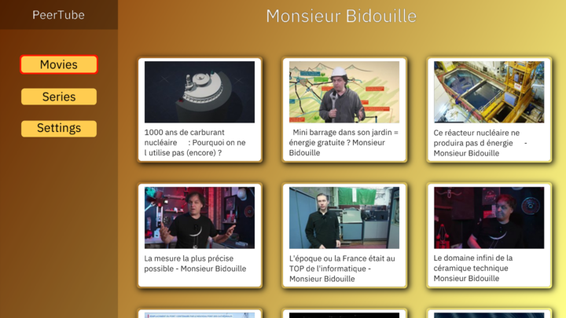

# XS-UI

Highly  **experimental**. 

An extra small Rust GPU accelerated UI framework with minimal dependencies. Focusing on compatibility for STB / SmartTVs.

Creates UI with a builder API inspired by [GPUI](https://github.com/zed-industries/gpui) and [Iced](https://github.com/iced-rs/iced).

Discord: [https://discord.gg/8VYgS7aD](https://discord.gg/8VYgS7aD)

## Features

- Minimal dependencies - No `wasm-bindgen`, `winit` nor `wgpu`
- Compile for Linux Wayland & WASM
- OpenGl / WebGl renderer
- Arrow key navigation
- HTTP Client
- Text rendering from alpha glyph atlas
- Flex layout
- Border + radius
- Gradient
- Box shadows
- Texture
- Animation

## Demo

Only arrow keys navigation works for now.

[https://xs-ui.vercel.app/](https://xs-ui.vercel.app/)



## TODO

- [ ] Improved event handling with more user inputs
- [ ] MSDF text rendering (currently using alpha glyph atlas)
- [ ] E2E Testing
- [ ] UI Components set
- [ ] Inspector
- [ ] Storybook like
- [ ] Documentation

## Crates

Main crates

- `xs` - Application creation + re-export xs libs
- `xs-canvas` - Minimal application creation
- `xs-core` - Internal stuffs shader between xs libraries
- `xs-backend-browser` - Browser/WASM backend
- `xs-backend-wayland` - Wayland backend
- `xs-renderer-opengl` - OpenGL/WebGl renderer
- `xs-text-system` - Text system library
- `xs-primitives` - Primitive components
- `xs-layout` - Flex layout system

Other notable crates. They are designed to be used in any project.

- `xs-animation` - Animations
- `xs-js-sys` - Javascript bindings
- `xs-http` - Http client & server
- `xs-websocket` - WebSocket server
- `xs-log` - Logging facilities

## Examples

```bash
# Run the peertube example
cargo run -p peertube
```

```bash
# Start a server that build & watch peertube
./serve.sh peertube
```

## Getting started

There is 2 ways about starting an application. 

- With the crate `xs`: Exports everything to create an application with a GPUI like builder API.
  Check the [examples](examples/)

- With the crate `xs-canvas`: This give you a minimal API to create an application allowing you to call low level graphics (OpenGl/webGl bindings abstraction). 
  This is ideal for testing shaders in seconds. [examples](crates/xs-canvas/examples/)

## Compatibilty with SmartTVs

Most SmartTVs do not support features enabled in recent Rust versions. It is required to disable those features and rebuild the Rust's std which, by default, enable them.

```bash
RUSTFLAGS="-Ctarget-cpu=mvp" cargo build -Zbuild-std=panic_abort,std --target wasm32-unknown-unknown --package peertube
```

## CLI

The development of the CLI is stalled and the current version is very limited. The goal is to provide a tool to manage `xs-ui` projects: serve, build, package...

It automatically reloads the wasm on code change, and requires `cargo-watch`.

```bash
# Serves the peertube example
cargo run -p xs-cli -- peertube
```

## Dependencies

- [log](https://crates.io/crates/log)
- [nanoserde](https://crates.io/crates/nanoserde)
- [zune-image](https://crates.io/crates/zune-image)
- [ab_glyph](https://crates.io/crates/ab_glyph)

## FAQ

- Why the name `xs-ui` ? 

  The name is not definitive and I didn't spend time looking for one. Inspired by Diocus, I wanted a name that can be reduced in 2 to 3 letters for the CLI tool.

  Futur candidate name: *joona* which stands for *fast* in Malinké.

- Why OpenGl/WebGl and not Vulkan/WebGPU?

  Because already knew OpenGl/GLSL.

  And, as I am focused on SmartTV compatibility, the WebGl is the only compatible API. Also, OpenGl & WebGl share the same shader language and almost the same API. I can write one renderer for both. 

## Thanks

- [makepad](https://github.com/makepad/makepad) & [miniquad](https://github.com/not-fl3/miniquad) for their bindings
- [wasm-ui](https://github.com/harrisonturton/wasm-ui) For the idea of a simple WASM compatible UI
- [shadetoy](https://www.shadertoy.com) Shader source of inspiration

## License

[GPL-3](LICENSE)
